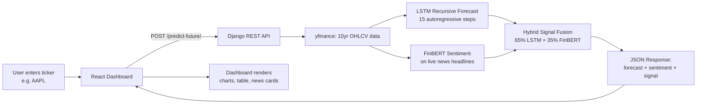

# 📈 Stock Prediction & Financial Intelligence Portal

> An end-to-end full-stack stock analysis and prediction platform powered by **Django REST Framework**, **React.js**, and an **AI/NLP Engine** that combines LSTM multi-day price forecasting with FinBERT financial news sentiment analysis.

---

## ✨ Features

- **Multi-Day Future Price Forecasting** — Predicts future stock prices for 7, 15, or 30 trading days ahead using autoregressive LSTM rollouts with dynamic 95% confidence intervals.
- **FinBERT Financial News Sentiment Analysis** — Evaluates live market headlines using `ProsusAI/finbert` (Financial BERT) to score market sentiment from `-1.0` (Extreme Bearish) to `+1.0` (Extreme Bullish).
- **Multimodal Hybrid Signal Synthesizer** — Blends technical forecasting (65%) and news sentiment (35%) to generate actionable recommendations: `STRONG BUY`, `BUY`, `HOLD`, `SELL`, `STRONG SELL`.
- **Historical Model Evaluation** — 100/200-day moving averages and test-set comparison with MSE, RMSE, and R² metrics.
- **JWT Authentication** — Secure user registration and login with access/refresh token flow and automatic token refresh in the frontend.
- **Currency-Aware** — Detects stock origin (US, India, UK, Europe, etc.) from the ticker suffix and renders prices in the correct currency symbol.
- **Modern Interactive React Dashboard** — Horizon selector, multimodal AI signal banner, daily target table with confidence bounds, live news sentiment cards, and a tabbed AI/Historical interface.

---

## 🧰 Tech Stack

| Layer | Technologies |
|---|---|
| **Frontend** | React 19, Vite 7, Tailwind CSS 4, DaisyUI 5, React Router 7, Axios |
| **Backend** | Django 6, Django REST Framework, SimpleJWT, django-cors-headers, python-decouple |
| **AI / ML** | Keras 3 / TensorFlow 2 (LSTM), HuggingFace Transformers (FinBERT), scikit-learn (MinMaxScaler, metrics), yfinance |
| **Data Viz** | matplotlib |
| **Database** | SQLite (Django default) |
| **Auth** | JWT (access + refresh tokens) |

---

## 🏗️ Project Architecture

```text
stock-prediction-portal/
├── backend-drf/                      # Django REST Framework Backend
│   ├── ai_engine/                    # AI & Quant ML Engine
│   │   ├── config.py                 # Hyperparameters, horizons & signal weights
│   │   ├── forecasting.py            # Recursive multi-day forecaster + confidence bounds
│   │   ├── sentiment_analyzer.py     # FinBERT NLP pipeline + hybrid signal synthesizer
│   │   └── README.md                 # AI engine technical guide
│   ├── api/                          # DRF API views, serializers, and endpoints
│   │   ├── views.py                  # Predict, Predict-Future, Sentiment & Top Stocks views
│   │   ├── urls.py                   # API routes
│   │   ├── serializers.py            # Request/response serializers
│   │   └── utils.py                  # Plot saving & currency detection
│   ├── accounts/                     # User authentication & JWT management
│   ├── stock_prediction_main/        # Django project configuration & settings
│   ├── stock-prediction-model.keras  # Pre-trained Keras LSTM model (~1.4 MB)
│   ├── .env.example                  # Environment variable template
│   └── media/                        # Generated chart images (auto-created at runtime)
│
├── frontend-react/                   # React Frontend (Vite + Tailwind + DaisyUI)
│   ├── src/
│   │   ├── components/
│   │   │   ├── dashboard/Dashboard.jsx   # Main AI dashboard UI
│   │   │   ├── Login.jsx / Register.jsx   # Auth pages
│   │   │   ├── AuthProvider.jsx           # Global login state (Context)
│   │   │   ├── PrivateRoutes.jsx         # Route guards
│   │   │   └── ...
│   │   ├── axiosinstancs.js           # Axios client with JWT auto-refresh
│   │   └── App.jsx                    # Root component & routing
│   ├── .env.example                   # Frontend env template
│   └── package.json
│
├── Resources/
│   └── stock_predicition_using_LSTM.ipynb  # Model training notebook
│
├── run_once.py                       # Downloads FinBERT model locally (run once)
├── PROJECT_DOCUMENTATION.md          # Full architecture & interview defense guide
├── ML_AI_EXPLANATION.md              # Hindi+English ML/AI concept explanation
├── INTERVIEW_QUESTIONS_1000.md       # 1000-question interview prep bank
├── PROJECT_RESUME.md                 # Resume-style project summary
└── README.md                         # This file
```

### High-Level Flow



---

## 🌐 API Endpoints

| Method | Endpoint | Description | Auth |
|:---|:---|:---|:---|
| `POST` | `/api/v1/predict-future/` | Multi-day LSTM forecast + FinBERT sentiment + hybrid signal | JWT |
| `POST` | `/api/v1/predict/` | Historical test prediction with 100/200 DMA and metrics (MSE, RMSE, R²) | JWT |
| `GET` | `/api/v1/sentiment/<ticker>/` | Fetch and analyze news headlines for a ticker | — |
| `GET` | `/api/v1/top-stocks/?number=N` | Global & domestic most active stocks screener | — |
| `POST` | `/api/v1/token/` | Obtain JWT access + refresh tokens (login) | — |
| `POST` | `/api/v1/token/refresh/` | Refresh an expired access token | — |
| `POST` | `/api/v1/register/` | Register a new user | — |

---

## 🚀 Quickstart

### Prerequisites

- **Python 3.10+** (with pip)
- **Node.js 18+** (with npm)
- Internet access (yfinance and FinBERT fetch live data)

### 1. Backend Setup

```powershell
# From the project root, activate the virtual environment
cd "d:\Projects Final\stock-prediction-portal"
.\env\Scripts\activate

# (Optional) Install PyTorch (CPU) + Transformers for FinBERT
pip install torch --index-url https://download.pytorch.org/whl/cpu
pip install transformers

# Run this once to download the FinBERT model locally
python run_once.py

# Navigate to the backend directory
cd backend-drf

# Copy the env template and set your secret key
copy .env.example .env
#   Edit .env and replace SECRET_KEY with your own

# Apply migrations and start the server
python manage.py migrate
python manage.py runserver
```

> **Note:** If `transformers` is not installed, the sentiment analyzer gracefully falls back to a keyword-based classifier, so the app never crashes.

### 2. Frontend Setup

```powershell
# In a new terminal, navigate to the frontend directory
cd "d:\Projects Final\stock-prediction-portal\frontend-react"

# Copy the env template
copy .env.example .env

# Install dependencies and start the Vite dev server
npm install
npm run dev
```

The React app runs on `http://localhost:5173` and connects to the Django backend at `http://127.0.0.1:8000`.

### 3. Use the App

1. Open `http://localhost:5173` in your browser.
2. Register an account or log in.
3. On the dashboard, enter a ticker (e.g. `AAPL`, `TSLA`, `RELIANCE.NS`, `TATAELXSI.BO`).
4. Choose a forecast horizon (7D / 15D / 30D) and click **Analyze AI**.
5. View the LSTM forecast chart, confidence bands, daily target table, FinBERT news sentiment, and the hybrid BUY/SELL signal.

---

## 🔑 Environment Variables

### Backend (`backend-drf/.env`)

| Variable | Description | Example |
|---|---|---|
| `SECRET_KEY` | Django secret key for token signing | generate one with `get_random_secret_key()` |
| `DEBUG` | Debug mode flag | `True` (dev) / `False` (prod) |

### Frontend (`frontend-react/.env`)

| Variable | Description | Example |
|---|---|---|
| `VITE_BACKEND_BASE_API` | Backend API base URL | `http://127.0.0.1:8000/api/v1` |
| `VITE_BACKEND_ROOT` | Backend root (for image URLs) | `http://127.0.0.1:8000` |

> See `.env.example` files in each directory for templates.

---

## 🧠 AI Engine Overview

### LSTM Price Forecasting (`ai_engine/forecasting.py`)

- **Model:** Stacked LSTM (128 → 64 units) + Dense (25 → 1), trained for 50 epochs on 10 years of AAPL data.
- **Input:** 100-day sliding window of scaled Close prices → shape `(1, 100, 1)`.
- **Prediction:** Autoregressive recursive rollout — each predicted day is fed back as input for the next step.
- **Uncertainty:** 95% confidence interval cone: `CI = price ± (1.96 × σ × √t)` based on daily log-return volatility (Brownian motion model).

### FinBERT News Sentiment (`ai_engine/sentiment_analyzer.py`)

- **Model:** `ProsusAI/finbert` — BERT fine-tuned on financial text (Financial PhraseBank + SEC filings).
- **Why not generic BERT?** Financial language has domain-specific polarity (e.g. "expenses increased" is negative, not positive).
- **Output:** Per-headline label (positive/negative/neutral) + confidence score. Aggregated into a normalized score from `-1.0` (bearish) to `+1.0` (bullish).
- **Fallback:** Keyword-based classifier if `transformers` is not installed.

### Hybrid Signal Fusion

```python
tech_score = clip(expected_pct_change / 5.0, -1, +1)   # LSTM momentum
composite  = (tech_score × 0.65) + (sent_score × 0.35) # weighted fusion
```

| Composite Score | Signal |
|---|---|
| ≥ 0.50 | STRONG BUY |
| 0.15 to 0.50 | BUY |
| -0.15 to 0.15 | HOLD / NEUTRAL |
| -0.50 to -0.15 | SELL |
| ≤ -0.50 | STRONG SELL |

---

## 📚 Documentation

| Document | Purpose |
|---|---|
| [**PROJECT_DOCUMENTATION.md**](./PROJECT_DOCUMENTATION.md) | Complete architecture, every file explained, interview defense guide |
| [**ML_AI_EXPLANATION.md**](./ML_AI_EXPLANATION.md) | Hindi+English step-by-step ML/AI concepts with dry runs and math |
| [**INTERVIEW_QUESTIONS_1000.md**](./INTERVIEW_QUESTIONS_1000.md) | 1000-question interview prep bank across all topics |
| [**PROJECT_RESUME.md**](./PROJECT_RESUME.md) | Resume-style project summary for job applications |
| [**backend-drf/ai_engine/README.md**](./backend-drf/ai_engine/README.md) | AI engine technical guide and talking points |

---

## 🔒 Security Notes

- **Never commit `.env` files.** The `.gitignore` already excludes them. Use the `.env.example` templates to configure your local environment.
- **Rotate the `SECRET_KEY`** if it was ever committed to a public repository. Generate a new one with:
  ```powershell
  python -c "from django.core.management.utils import get_random_secret_key; print(get_random_secret_key())"
  ```
- Set `DEBUG=False` in production.
- This project is for **educational purposes** and is not financial advice.

---

## ⚠️ Disclaimer

This project is built for learning and interview preparation. Stock market predictions are inherently uncertain. The LSTM model and FinBERT sentiment scores are experimental and should **not** be used for real trading or investment decisions.

---

## 📄 License

This project is open for educational use. Feel free to learn from it, fork it, and build on it.
